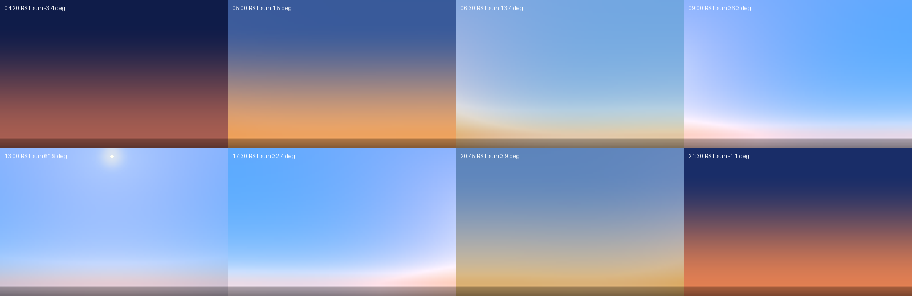
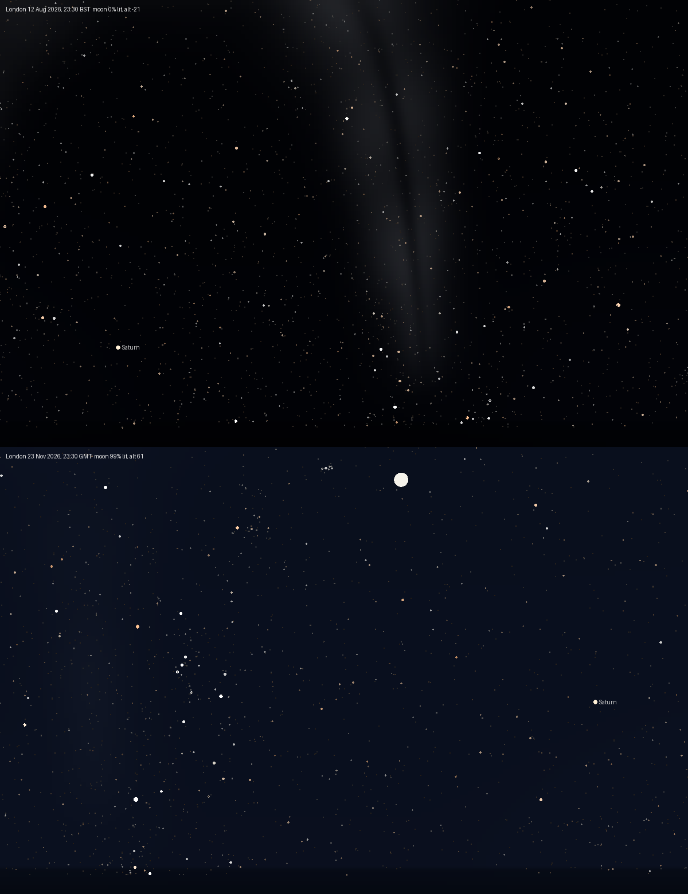
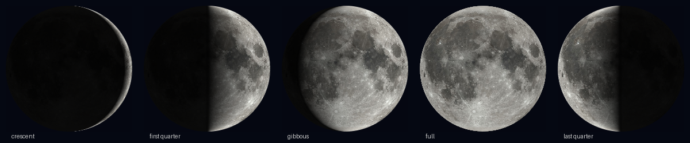
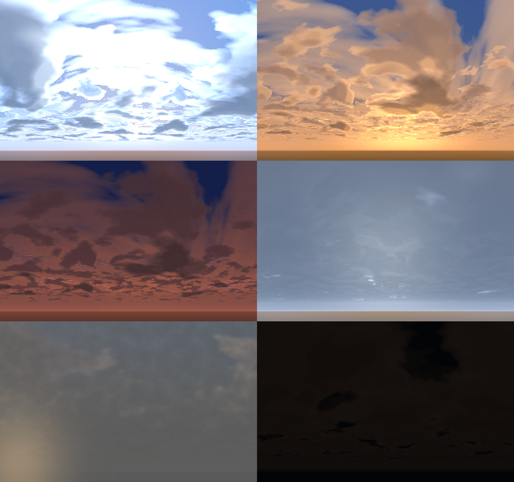

# Sky

A macOS menu bar app that paints a live sky behind your desktop icons: the Sun where it really is
for your location and time, the real night sky from the Yale Bright Star Catalogue, and clouds,
rain and snow from the current weather.

All astronomy runs locally. Only the weather (Open-Meteo, every 15 minutes) uses the network,
and the last result is cached so the sky keeps working offline.

## Build and run

Requires macOS 14+ and Xcode 15+ (or the Swift 5.9+ toolchain).

```sh
swift test                 # astronomy + weather tests (also run on Linux)
swift run SkyWallpaper     # launches the menu bar app and the desktop sky
```

Or open `Package.swift` in Xcode and run the `SkyWallpaper` scheme. Use the sun-and-horizon
menu bar icon to open Settings, set your coordinates, and scrub through the day or the seasons.

## Packaging

`Scripts/package.sh` builds `dist/Sky.app` (menu bar only, with its icon and a
"Open Sky when you log in" setting) and wraps it in a disk image. It makes three kinds of build:

| Build | Command | Notes |
|---|---|---|
| Personal | `Scripts/package.sh` | Signed ad hoc. Right-click > Open the first time. Accessibility access must be granted again after each rebuild. |
| Developer ID | `SIGN_ID="Developer ID Application: …" NOTARY_PROFILE=sky Scripts/package.sh` | Signed and notarised DMG that opens normally on any Mac. Use it to sell or share directly. |
| Mac App Store | `APP_STORE=1 TEAM_ID=… SIGN_ID="Apple Distribution: …" INSTALLER_ID="3rd Party Mac Developer Installer: …" PROFILE=… Scripts/package.sh` | Sandboxed `.pkg` for Transporter. Built with `-D APP_STORE`, which leaves out the Dock effects (a sandboxed app can't use Accessibility to find the Dock). |

The script header lists every setting. `Scripts/make_icon.py` redraws `Resources/AppIcon.png`.

## Display modes

Choose in Settings: **Live sky** (default, animated window behind the icons), **Still image**
(sets a rendered picture as the normal wallpaper every 5 minutes), or **Live, still on battery**.
Your own wallpaper is put back when Sky quits.







## Weather

Clouds come in three decks (cirrus at 9 km, altocumulus at 4 km, cumulus at 1.4 km) with the
cover Open-Meteo reports for each. Every pixel is a ray that meets each deck where its plane
crosses it on a curved Earth, so clouds crowd towards the horizon as real ones do. They are lit
by the Sun, or the Moon at night, with self-shadowing and a silver lining towards the light, and
high cloud stays pink after sunset because it still sees the Sun. Low visibility adds fog banks.
Thunderstorms flash in several strokes, light the cloud from inside and sometimes strike the ground.

Drops land on the glass, cling, then run down in fits and starts once they are big enough,
swallowing drops in their way. On the desktop each drop shows the sky behind it upside down.
Rain splashes along the bottom of the screen and on the Dock; snow settles there, slides off the
ends of the Dock, and melts when it warms up (the reported snow depth sets how much is already lying).

Settings choose where drops go (**off**, **on the desktop**, the default, or **over all windows**),
whether rain and snow touch the Dock, and a **Preview weather** menu to try every effect now.
Finding the Dock needs Accessibility access (System Settings > Privacy & Security > Accessibility),
because macOS has no other way to tell an app how wide the Dock is. The Dock effects are drawn
on a click-through window just above the Dock, so clicks still reach it.



## Layout

| Path | What it is |
| --- | --- |
| `Sources/SkyCore/AstroMath.swift` | Julian day, sidereal time, refraction, equatorial to horizontal |
| `Sources/SkyCore/SolarCalculator.swift` | NOAA / Meeus sun position, sunrise, sunset, twilight, polar day and night |
| `Sources/SkyCore/StarCatalog.swift` | Bundled Bright Star Catalogue, precession from J2000, star colours |
| `Sources/SkyCore/Weather.swift` | `WeatherProvider` protocol, Open-Meteo client, caching `WeatherService` |
| `Sources/SkyCore/Atmosphere.swift` | Preetham daylight sky model, screen projection, low-res sky background renderer |
| `Sources/SkyCore/Moon.swift` | Moon position (Meeus ch. 47) and phase (ch. 48) |
| `Sources/SkyCore/MoonImage.swift` | Renders the Moon as a lit sphere from the NASA surface map |
| `Sources/SkyCore/Planets.swift` | Mercury to Saturn from JPL Keplerian elements; galactic coordinates and Milky Way brightness |
| `Sources/SkyCore/Clouds.swift` | Gradient noise, cloud decks, cloud and fog renderer |
| `Sources/SkyCore/GlassRain.swift` | Drops on the glass: landing, sliding, merging, trails, drying |
| `Sources/SkyCore/SnowCover.swift` | Snow lying on the ground and on the Dock's shelf |
| `Sources/SkyCore/Lightning.swift` | Flash timing and forked bolt shapes |
| `Sources/SkyCore/SkyScene.swift` | Combines sun, stars and weather into one frame's scene and sky colours |
| `Sources/SkyWallpaper/` | The app: live desktop windows, still-image wallpaper mode, renderer, settings |
| `Scripts/package.sh` | Builds the .app, DMG or App Store package |
| `Scripts/build_star_catalog.py` | Regenerates `Resources/bsc5.csv` from the catalogue JSON |

## Accuracy

Unit tests check the maths against worked examples in Meeus, *Astronomical Algorithms*
(sun coordinates 25.a, equation of time 28.a, sidereal time 12.a, precession 21.b) and against
published 2026 sunrise and sunset times for London and Sydney, plus polar day and night at Tromsø.
Sun position is good to about 0.01° and rise/set times to about a minute. Stellar proper motion
is not applied yet (under 0.1° for every bright star over a century, invisible at wallpaper scale).

## Data

Star data: Yale Bright Star Catalogue, 5th revised edition (Hoffleit & Warren 1991, CDS V/50),
converted from the JSON transcription at github.com/brettonw/YaleBrightStarCatalog.
Moon surface: NASA LRO colour map, [NASA Scientific Visualization Studio 4720](https://svs.gsfc.nasa.gov/4720) (public domain).
Weather: [Open-Meteo](https://open-meteo.com/), free for non-commercial use (CC BY 4.0 attribution).

## Roadmap

1. Scaffold, astronomy and weather model (this commit)
2. Daytime sky: Preetham scattering model, sun disc, display modes (merged)
3. Seasonal view width: wide enough to show sunrise and sunset all year (merged)
4. Night sky: Moon with phase, planets, Milky Way, twilight on the Sun's side; realistic textured Moon (merged)
5. Weather: sunlit cloud decks, fog, lightning, rain on the glass, splashes and snow on the Dock (this branch)
6. Multi-display, power saving, launch at login, still-image mode
